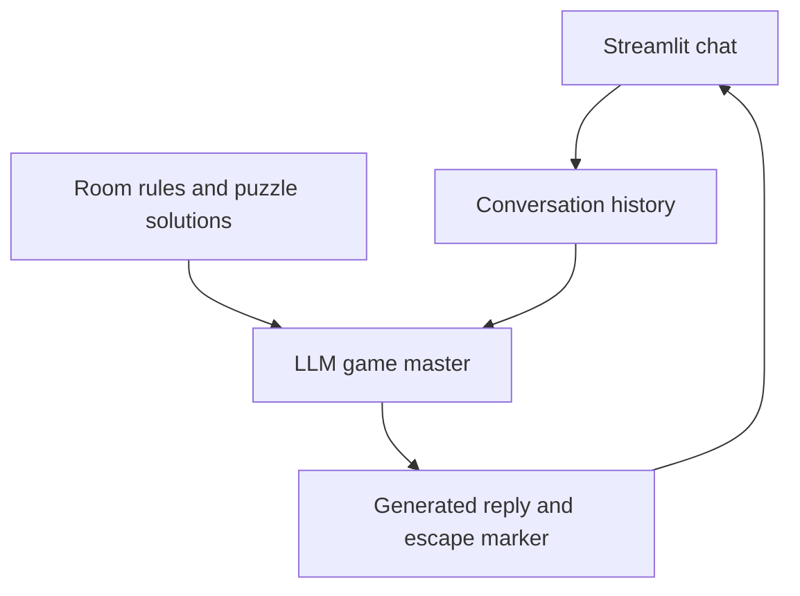
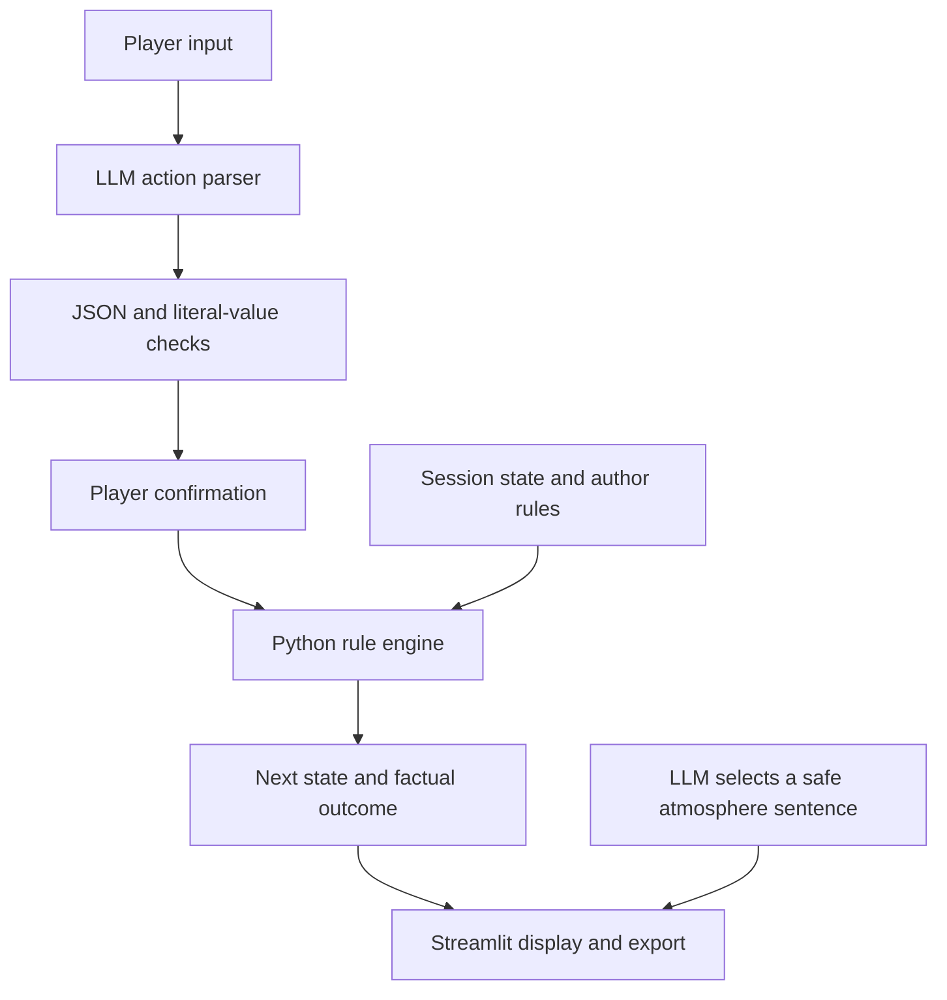

# System architecture

## Version 1: conversational baseline

`app.py` owns the UI and history. `v1.py` sends the full room rules and history
through `llm.py`. The model interprets actions, remembers items and decides outcomes.
The UI trusts its `[ESCAPED]` marker; no engine independently verifies a V1 victory.
The export therefore has `state: null`. This is an intentional baseline limitation.

## Version 2: validated transitions

The diagram shows the accepted-action path. Invalid proposals return a rejection;
cancelled proposals do not reach the engine. `engine.apply` checks inventory,
passwords and prerequisites, returning a copied next state and authored outcome.
Only Python can change inventory, puzzle flags or escape status. The UI stores
that state before requesting optional atmosphere. An atmosphere failure does not
undo a validated transition. Parser/API failure before confirmation applies no move.

The parser receives the current message and action schema, not author solutions or
conversation history. Entered codes and answers must occur in the player's input.
Atmosphere generation selects one of three fixed sentences and receives no game
secrets. This prevents generated narration from overriding engine-authored facts.
It does not guarantee correct interpretation: a player must review the proposal.

## Shared components and boundaries

- `app.py`: version selection, restart, history, confirmation and JSON export.
- `world.py` and `engine.py`: story, puzzle rules and V2 state transitions.
- `llm.py`: explicit provider selection, timeout and sanitized error messages.
- `.env`: private credentials; `.env.example`: blank configuration template.
- Offline V2 replaces only the LLM parser with deterministic grammar and omits atmosphere.
- Gemini generate_content is the demonstrated route. Interactions and Groq adapters
  have mocked tests but no successful live session evidence in this submission.

Both versions are available on main. The version-1 and version-2 branches preserve
initial development milestones; main contains the final integrated application.
